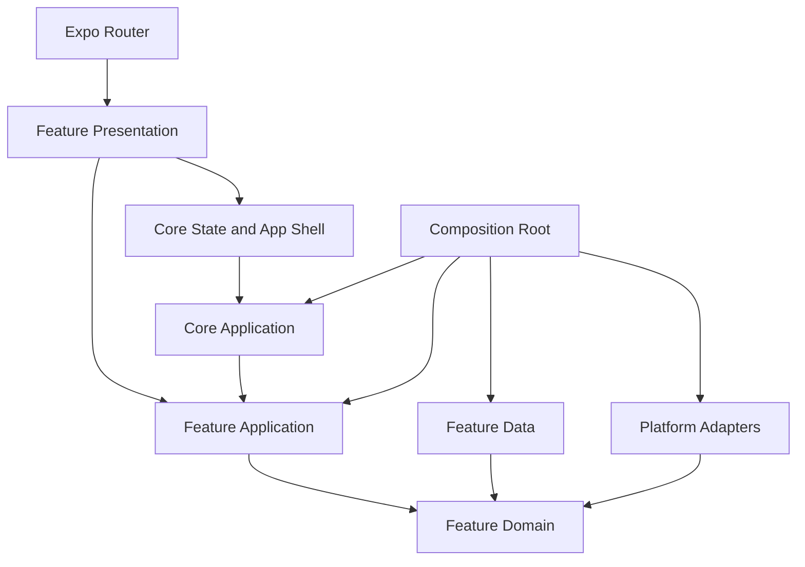

<div align="center">

# Vettingo Mobile

### A cross-platform recruitment and candidate assessment application

Vettingo Mobile brings candidate, employer, and HR workflows together in a shared application built for Android, iOS, and the web.

<br />


</div>

---

## Overview

**Vettingo Mobile** is the mobile client of the Vettingo recruitment platform.

The application provides dedicated experiences for candidates, employers, and HR teams, including job discovery, application tracking, candidate browsing, technical assessments, CV editing, and recruitment workflows.

It is built with **React Native**, **TypeScript**, **Expo SDK 58**, and **Expo Router**, using a feature-first Clean Architecture.

> The application currently runs with local demo data. Backend authentication, server-side recruitment operations, and push notification delivery are pending integration. The notification inbox supports the backend API when an authenticated session is available. Some screens remain under active UI development.

### Supported platforms

- **Android**
- **iOS**
- **Web**

### Supported roles

- **Candidate**
- **Employer**
- **Human Resources (HR)**

The application interface is primarily in Turkish.

---

## Features

### Authentication and account flows

- Login and registration forms
- Form validation with React Hook Form and Zod
- Login-code and email-verification screens
- Password recovery screens
- Password visibility controls
- Remember-me preference
- Terms and privacy dialogs
- Role-specific navigation
- Development-only preview sessions

Authentication and verification currently use demo behavior. Email delivery, OTP verification, OAuth, and password changes require backend integration.

### Candidate experience

- Candidate dashboard
- Job search and filter controls
- Working model, salary, and experience filters
- Recommended job listings
- Application status tracking
- Technical assessment access
- CV and profile editing
- Personalized job listings
- Account and help pages

### Employer and HR experience

- Dedicated dashboards
- Job posting lists
- Candidate lists and search
- Candidate stage filters
- Scout candidate discovery
- Candidate comparison
- Local candidate decisions and interview planning
- Job requisition workflow
- Company profile presentation

### Technical assessments

- Multiple-choice assessment flow
- Question navigation
- Remaining-time tracking
- Locally saved answers
- Assessment submission state
- Answer locking after completion

Assessment answers and completion state are stored locally. Server-side submission and scoring are pending integration.

### CV and profile management

- Profile summary editing
- Skills management
- Experience and education editing
- Target role information
- CV document selection
- Locally saved profile changes

Selected documents are not uploaded or parsed by a backend.

The dashboard checks CV existence through `GET http://localhost:5083/api/evaluations/cv/user/{userId}/exists`
using the session's GUID `userId` and Bearer `accessToken`. A raw `false` response shows the
non-dismissible “CV oluştur” card; `true` hides it. Loading, request failures, and missing backend
credentials do not count as a missing CV. Failed checks show a retry action. The check runs
again when the dashboard gains focus; locally saving a CV does not change the server result.

The full URL is in `src/features/cv/data/repositories/ApiCvRepository.ts`. For a physical
device use the server's LAN IP; for an Android emulator use `10.0.2.2` in place of `localhost`.
Demo login does not supply backend credentials. EvaluationService's CV tables must
exist in the database; schema changes follow the backend's migration process.

### Notifications and account navigation

- Shared notifications page for all three roles
- API-backed notification cards with title, message, creation date, and unread status
- Notification preference control
- Shared application header and back navigation
- Profile-tab selection across account pages
- Role-specific help content

The notifications page requests the user's latest 80 notifications whenever it opens, with loading, empty, error, and retry states. Push notifications and real-time delivery are pending integration.

The full request URL is written directly in the `list` method of `src/features/account/data/repositories/ApiNotificationsRepository.ts` and can be edited there. The current endpoint is `http://localhost:5149/api/notifications/user/{userId}`. On a physical device, replace `localhost` with the computer's LAN IP; on an Android emulator, use `10.0.2.2`.

The endpoint requires a real backend `userId` and `accessToken` in the active `Session`; requests include the token in the `Authorization: Bearer ...` header. Demo login does not provide these fields, so demo sessions show a sign-in message. Connecting the authentication API remains a separate integration.

The backend controls the newest-first order and 80-item limit. Cards display `title`, `message`, and `createdAt`; `isRead` controls the new-notification badge.

### Local persistence

- Account-scoped workspace storage
- Role-scoped application data
- Demo session restoration
- Saved profile and workflow state
- Storage error feedback

Passwords are not persisted.

---

## Architecture

Vettingo Mobile follows a **feature-first Clean Architecture**.

Each feature owns its business models, application workflows, data sources, platform adapters, and presentation components. Features contain only the layers they need.



### Application layers

| Layer | Responsibility |
|---|---|
| **Domain** | Entities, business policies, repository contracts, and device ports |
| **Application** | Use cases, queries, and feature workflows |
| **Data** | Demo fixtures, repositories, persistence, and data mapping |
| **Infrastructure** | Platform and device integrations |
| **Presentation** | Screens, cards, forms, navigation interactions, and UI state |

### Core and shared modules

| Module | Responsibility |
|---|---|
| **Core** | Session lifecycle, workspace orchestration, application state, and shared application shell |
| **Shared** | Reusable UI primitives, utilities, domain types, and adapters |
| **Composition** | Dependency construction and injection |

Domain and application code remain independent of React Native and Expo.

Concrete dependencies are connected in `src/composition/createAppServices.ts`. ESLint enforces the architecture boundaries.

See [Architecture](docs/ARCHITECTURE.md) for implementation details.

---

## Application modules

| Module | Responsibility |
|---|---|
| **Auth** | Demo identity, authentication forms, verification screens, and role routing |
| **Jobs** | Job catalog, search, filters, and listing cards |
| **Applications** | Application models, status tracking, and local application workflows |
| **Candidates** | Candidate discovery, profiles, comparisons, decisions, and interview workflows |
| **Assessment** | Questions, timing, answers, and assessment state |
| **CV** | CV models, document selection, and profile editing |
| **Requisitions** | Job posting drafts, validation, and local publishing workflows |
| **Account** | Account pages, company presentation, help content, and notifications |
| **Dashboard** | Role-specific home screens composed from feature components |

---

## Technology stack

| Category | Technologies |
|---|---|
| **Language** | TypeScript |
| **UI framework** | React Native, React |
| **Application framework** | Expo SDK 58 |
| **Navigation** | Expo Router, React Navigation |
| **Web support** | React Native Web |
| **Forms** | React Hook Form |
| **Validation** | Zod |
| **Local storage** | AsyncStorage |
| **Animations** | React Native Reanimated |
| **Icons** | Expo Vector Icons |
| **Document selection** | Expo Document Picker |
| **Testing** | Jest, jest-expo, React Native Testing Library |
| **Code quality** | ESLint, Prettier, TypeScript |
| **Build tooling** | Metro, Expo CLI, EAS Build |
| **Continuous integration** | GitHub Actions |

---

## Project structure

```text
Vettingo-Mobil/
├── src/
│   ├── app/                     # Expo Router routes and layouts
│   ├── composition/             # Dependency injection
│   ├── core/
│   │   ├── application/         # Session and workspace orchestration
│   │   ├── data/                # Persistence and mapping
│   │   ├── domain/              # Workspace entities and contracts
│   │   └── presentation/        # App shell and state providers
│   ├── features/
│   │   ├── account/
│   │   ├── applications/
│   │   ├── assessment/
│   │   ├── auth/
│   │   ├── candidates/
│   │   ├── cv/
│   │   ├── dashboard/
│   │   ├── jobs/
│   │   └── requisitions/
│   └── shared/
│       ├── data/
│       ├── domain/
│       ├── infrastructure/
│       └── presentation/
├── assets/
│   └── images/
├── tests/
├── docs/
├── .github/
│   └── workflows/
├── app.json
├── eas.json
├── package.json
└── tsconfig.json
```

---

## Getting started

### Prerequisites

- **Node.js 24 LTS**
- npm
- Git
- Expo Go compatible with SDK 58, or a development build
- Android Studio for Android emulator development
- macOS and Xcode for local iOS builds

The project declares support for Node.js `^22.13.0`, `^24.3.0`, or `>=26.0.0`. Node.js 23 and 25 are unsupported.

### Clone the repository

```bash
git clone https://github.com/emreucbudak/Vettingo-Mobil.git
cd Vettingo-Mobil
```

### Install dependencies

```bash
npm ci
```

### Start the development server

```bash
npm start
```

Open the project in a compatible Expo Go installation or a development build.

To clear the Metro cache:

```bash
npm start -- --clear
```

---

## Running locally

### Android

```bash
npm run android
```

An Android emulator or a connected device is required.

### iOS

```bash
npm run ios
```

The iOS Simulator requires macOS and Xcode.

### Web

```bash
npm run web
```

### Native development builds

Generate and run native projects through Expo when needed:

```bash
npx expo run:android
```

```bash
npx expo run:ios
```

Native project directories are generated through Expo's Continuous Native Generation workflow.

---

## Configuration

### Application configuration

`app.json` contains application settings, including:

- Application name and slug
- Android and iOS identifiers
- URL scheme
- Icons and splash screen
- Expo plugins
- Web bundler configuration

### Build configuration

`eas.json` defines the following profiles:

| Profile | Purpose |
|---|---|
| **development** | Internal development client |
| **preview** | Internal distribution with an Android APK |
| **production** | Production builds with automatic version-code increments |

The current demo does not require a backend URL or API credentials to run.

When connecting the backend, add feature-specific data adapters and wire them through the composition root.

---

## Backend integration status

The mobile application primarily uses local repositories and bundled fixtures. The notification inbox has an API repository that requires a backend-authenticated session.

| Capability | Current behavior |
|---|---|
| **Authentication** | Local demo sessions |
| **Email verification** | UI and navigation flow |
| **Password recovery** | UI and navigation flow |
| **Jobs and candidates** | Bundled demo catalogs |
| **Applications and decisions** | Local workspace state |
| **CV documents** | Device selection without upload or parsing |
| **Interview planning** | Local state without invitation delivery |
| **Assessments** | Local answers and completion state |
| **Notifications** | Latest 80 notifications via API; requires backend user ID and access token |
| **Company information** | Demo presentation |

Production integration requires server-side authentication, authorization, token handling, API-backed repositories, and synchronization.

Local role-based routing controls the demo interface; it does not replace backend authorization.

---

## Testing and code quality

### Type checking

```bash
npm run typecheck
```

### Linting

```bash
npm run lint
```

### Tests

```bash
npm test -- --runInBand
```

The test suite covers business workflows, storage behavior, screen interactions, and navigation.

### Expo dependency compatibility

```bash
npx expo install --check
```

### Project diagnostics

```bash
npx expo-doctor
```

### Web export

```bash
npm run export:web
```

GitHub Actions runs dependency installation, type checking, linting, tests, Expo compatibility checks, and web export on pushes and pull requests.

---

## Dependency maintenance

Use Expo's installer when adding or updating packages:

```bash
npx expo install <package-name>
```

Check dependency security separately:

```bash
npm audit
```

As of **October 25, 2026**, the dependency audit reports four high-severity entries associated with the same `node-forge` signature-verification advisory and its dependency chain. No patched npm release was available at that check.

See [GHSA-86w9-cpqp-85rv](https://github.com/advisories/GHSA-86w9-cpqp-85rv).

The project also applies a version-scoped Zod override for Expo CLI `58.1.15`. Reassess this override when updating the CLI.

Review audit recommendations before applying them. `npm audit fix --force` can select an older Expo SDK that is incompatible with the application.

---

## Building with EAS

### Sign in

```bash
npx eas-cli@latest login
```

### Android preview APK

```bash
npx eas-cli@latest build --platform android --profile preview
```

Or use the project script:

```bash
npm run build:android
```

### Android production build

```bash
npx eas-cli@latest build --platform android --profile production
```

### iOS production build

```bash
npx eas-cli@latest build --platform ios --profile production
```

Development builds require `expo-dev-client`:

```bash
npx expo install expo-dev-client
```

EAS project configuration, signing credentials, and store accounts must be configured before distribution.

---

## Engineering practices

- Feature-owned models and workflows
- Framework-independent domain and application layers
- Repository and platform-port abstractions
- Dependency injection through a composition root
- Account- and role-scoped local persistence
- Shared UI components and design tokens
- Accessible labels for interactive controls
- Automated architecture boundary checks
- Type checking and linting
- Workflow, screen, and navigation tests
- Continuous integration with GitHub Actions

---

## Related projects

| Project | Repository |
|---|---|
| **Backend** | [Vettingo](https://github.com/emreucbudak/Vettingo) |
| **Web frontend** | [Vettingo Frontend](https://github.com/emreucbudak/Vettingo-Frontend) |
| **Mobile application** | [Vettingo Mobile](https://github.com/emreucbudak/Vettingo-Mobil) |

---

## Contributing

1. Fork the repository.
2. Create a feature branch.

```bash
git checkout -b feature/your-feature-name
```

3. Keep changes within the owning feature.
4. Follow the architecture rules in `AGENTS.md`.
5. Add or update tests when behavior changes.
6. Run the project checks.

```bash
npm run typecheck
npm run lint
npm test -- --runInBand
npx expo install --check
npm run export:web
```

7. Commit your changes and open a pull request.

---

## License

See [LICENSE](LICENSE) for the license text.

---

<div align="center">

Built with **React Native**, **TypeScript**, **Expo**, and a feature-first Clean Architecture.

</div>
